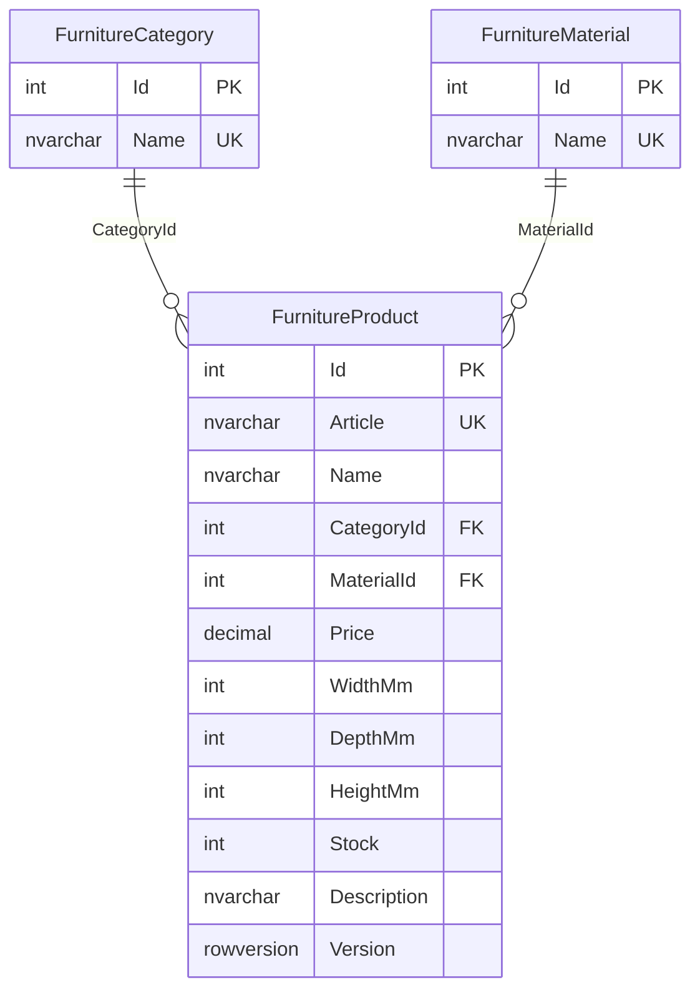

# Структура базы PR15_KitchenFurniture

Одна основная таблица и две справочные таблицы.

| Поле FurnitureProduct | Тип SQL Server | Назначение |
| --- | --- | --- |
| Id | int IDENTITY, PK | Автоматический номер товара |
| Article | nvarchar(30), UNIQUE | Уникальный артикул |
| Name | nvarchar(120) | Название |
| CategoryId | int, FK | Категория из справочника |
| MaterialId | int, FK | Материал из справочника |
| Price | decimal(12,2) | Цена в рублях, неотрицательная |
| WidthMm / DepthMm / HeightMm | int | Размеры в мм, 1–10 000 |
| Stock | int | Количество на складе, 0–1 000 000 |
| Description | nvarchar(2000) | Описание; по умолчанию пустая строка |
| Version | rowversion | Автоматическая версия для контроля параллельных изменений |

У обеих справочных таблиц: `Id int IDENTITY PRIMARY KEY`, `Name nvarchar(60) NOT NULL UNIQUE`. Все поля основной таблицы обязательны на уровне SQL; необязательное описание хранится пустой строкой. Внешние ключи запрещают назначать несуществующие категорию и материал и удалять используемые справочники. Каскадного удаления товаров нет.

Справочники:

- Категории: кухонные гарнитуры, напольные шкафы, навесные шкафы, обеденные столы, кухонные стулья, кухонные уголки.
- Материалы: ЛДСП, МДФ, массив дуба, массив бука, металл / МДФ.

Запрос каталога соединяет все три таблицы по внешним ключам. Редактирование и удаление учитывают Id и Version. Для каждого CategoryId и MaterialId создан индекс.
