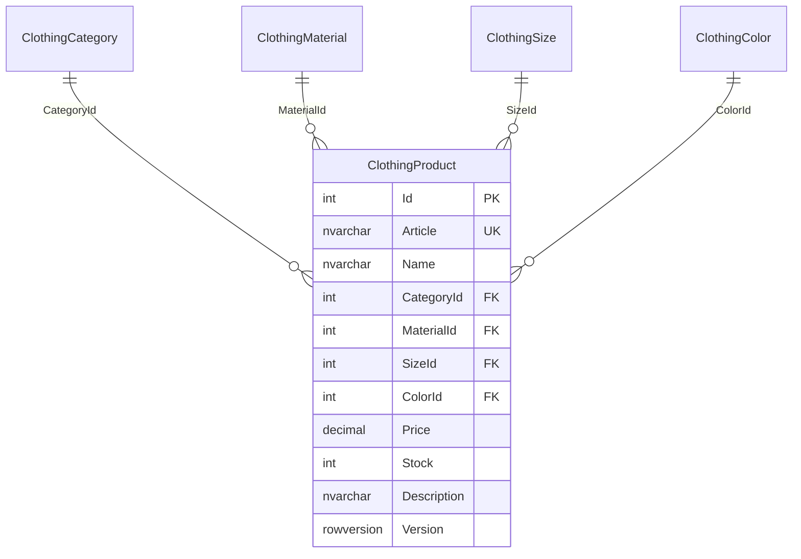

# Структура базы PR16_AlisaClothes

Основная таблица ClothingProduct ссылается на четыре справочника. В каждом справочнике есть `Id int IDENTITY PRIMARY KEY` и `Name nvarchar(60) NOT NULL UNIQUE`.

| Поле ClothingProduct | Тип SQL | Назначение |
| --- | --- | --- |
| Id | int IDENTITY, PK | Автоматический номер |
| Article | nvarchar(30), UNIQUE | Артикул |
| Name | nvarchar(120) | Название |
| CategoryId | int, FK | Куртки / джемперы / жакеты |
| MaterialId | int, FK | Состав материала |
| SizeId | int, FK | Размер: рост в сантиметрах |
| ColorId | int, FK | Цвет |
| Price | decimal(12,2) | Неотрицательная цена в рублях |
| Stock | int | Остаток 0–1 000 000 |
| Description | nvarchar(2000) | Описание, по умолчанию пустая строка |
| Version | rowversion | Версия для контроля параллельных изменений |

Все поля обязательны на уровне SQL. Необязательное описание хранится пустой строкой. Ограничения CHECK запрещают пустые название и артикул, отрицательные цену и остаток. Уникальный индекс запрещает повторяющиеся артикулы. Внешние ключи не допускают несуществующие значения справочников и удаление используемых значений. На всех четырёх полях связей созданы индексы.

Запрос каталога использует JOIN со всеми четырьмя справочниками. Изменение и удаление выполняются по Id и Version. Значения Version генерируются SQL Server.

## Начальное наполнение

- 24 товара: 8 курток, 8 джемперов, 8 жакетов.
- 3 категории.
- 6 материалов: хлопок 100%, хлопок / полиэстер, акрил / хлопок, полиэстер 100%, вискоза / полиэстер, шерсть / акрил.
- 11 размеров: 104, 110, 116, 122, 128, 134, 140, 146, 152, 158, 164.
- 8 цветов: синий, чёрный, бежевый, бирюзовый, красный, жёлтый, серый, белый.
